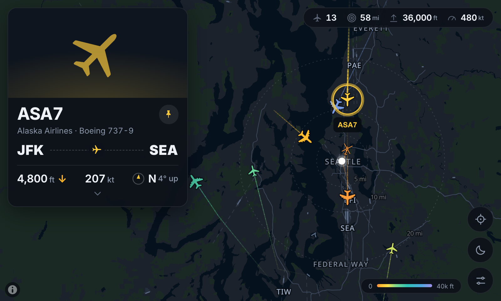
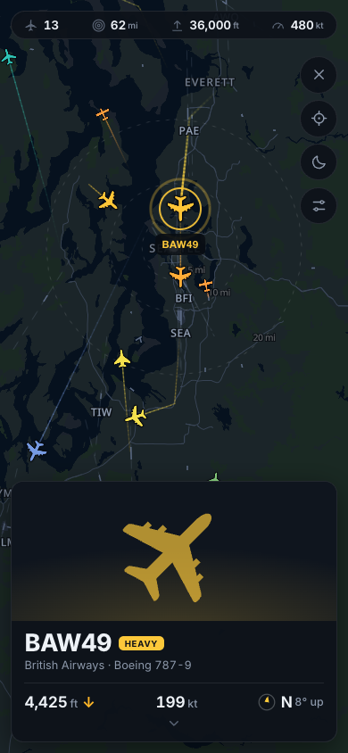

# Dave's Custom Flight Radar Dashboard



A live map of the aircraft your own antenna hears, built for a Raspberry Pi and a small touchscreen. Tap a plane to see what it is and where it's going.

## What's on screen

| Part | What it shows |
|---|---|
| Map | Dark map of your area with water, parks, highways, airports, and runways. Pinch to zoom. Range rings at 5, 10, and 20 miles |
| Planes | One shape each for jets, heavies, props, helicopters, and military aircraft. Color is altitude. A trail shows the last 5 minutes |
| Flight card | Photo, callsign, airline, type, route, altitude, speed, and where to look in the sky ("SE, 40° up"). The arrow under it opens tail number, year built, squawk, climb rate, heading, and distance |
| Today | Planes seen today, and the farthest, highest, and fastest |
| Alerts | "No signal" when the receiver stops hearing messages. A red banner for squawk 7500, 7600, or 7700 |
| Details page | The slider icon opens `/debug`: every raw field, message rate, setup status, and the max-age setting |

Left alone, the card follows the plane highest in the sky. Tap a plane to pin it for a minute. The screen dims itself after sunset.



The screenshots use demo traffic. With lookups on, the card shows a photo of the airframe in place of the silhouette.

## Try it without a receiver

```bash
cd flight_dashboard
python3 -m venv venv
venv/bin/pip install -r requirements.txt
venv/bin/python3 download_map.py --lat 47.6062 --lon -122.3321
DEMO_MODE=true venv/bin/python3 app.py
```

Open http://127.0.0.1:8080. Demo mode flies 13 sample flights around Seattle. Set `DEMO_SCENARIO` to `emergency`, `stalled`, or `empty` to see those states.

## Install on a Raspberry Pi

You need a Pi with an RTL-SDR dongle and the [FlightRadar24 feeder](https://www.flightradar24.com/share-your-data), which runs dump1090.

1. Make the feeder write its aircraft list. In `/etc/fr24feed.ini`:
   ```ini
   procargs=--write-json /run/dump1090 --write-json-every 1
   ```
   Then run `sudo systemctl restart fr24feed`.
2. Install the dashboard:
   ```bash
   git clone https://github.com/Dave781/Custom-Flight-Radar-Dashboard.git
   cd Custom-Flight-Radar-Dashboard/flight_dashboard
   python3 -m venv venv
   venv/bin/pip install -r requirements.txt
   ```
3. Tell it where the antenna is:
   ```bash
   cp .env.example .env
   # edit .env and set HOME_LAT and HOME_LON
   ```
   `.env` is gitignored, so your location is never committed.
4. Download the data:
   ```bash
   venv/bin/python3 download_map.py   # map and airports for your area, about 25 MB
   venv/bin/python3 download_db.py    # aircraft types and tail numbers
   ```
5. Start it at boot with `./install.sh`, or run it by hand with `./run.sh`.

The dashboard is at `http://your-pi-ip:8080`.

### Kiosk screen on a second Pi

Create `~/.config/autostart/adsb-dashboard.desktop` on the display Pi:

```ini
[Desktop Entry]
Type=Application
Name=ADS-B Dashboard
Exec=chromium --kiosk --start-fullscreen --no-first-run --password-store=basic http://BACKEND-PI-IP:8080/
X-GNOME-Autostart-enabled=true
```

The layout is sized for 800×480. Larger touchscreens scale up by themselves. To set the size by hand, add `?scale=1.25` to the address.

## Settings

Set these in `flight_dashboard/.env` or as environment variables.

| Variable | Default | What it does |
|---|---|---|
| `HOME_LAT`, `HOME_LON` | none | Antenna location. Required |
| `DASHBOARD_TITLE` | `Dave's ADS-B Radar` | Browser tab title |
| `PORT`, `HOST` | `8080`, `0.0.0.0` | Where the server listens |
| `MAP_RANGE_MI` | `25` | Miles from the antenna to the edge of the screen |
| `RANGE_RINGS_MI` | `5,10,20` | Range ring distances |
| `TRAIL_SECONDS` | `300` | Trail length |
| `SEEN_THRESHOLD` | `120` | Seconds of silence before a plane leaves the map |
| `STALL_SECONDS` | `180` | Seconds without new messages before "No signal" shows |
| `LOOKUPS` | `true` | `false` turns off route and photo lookups |
| `MAP_RADIUS_MI`, `MAP_MAX_ZOOM` | `80`, `12` | How much map `download_map.py` stores |
| `DEMO_MODE` | `false` | `true` uses sample traffic |

## What leaves your network

- **Map:** nothing while the dashboard runs. `download_map.py` fetches the map once and the Pi serves it from disk.
- **Routes and photos:** when a plane is selected, the Pi sends its callsign to adsbdb.com and its ICAO hex to planespotters.net, then caches the answer for a day. Your location is not sent. The browser loads the photo from planespotters.net. `LOOKUPS=false` turns both off.

A route is shown only when the plane's position fits it. Callsign tables go stale, and a plane landing in Seattle labeled "SFO → PDX" is worse than no label.

## Troubleshooting

| Symptom | Check |
|---|---|
| "No signal" alert | The decoder is running but hears nothing. Unplug and replug the RTL-SDR dongle, then `sudo systemctl restart fr24feed` |
| "Decoder offline" alert | `aircraft.json` is missing or stale. `ls -la /run/dump1090/` and `sudo journalctl -u fr24feed -n 50` |
| "No map yet" | Run `venv/bin/python3 download_map.py` and restart the dashboard |
| Planes but no type or tail number | Run `venv/bin/python3 download_db.py` |
| No route on a flight | Private and military flights have none. Airline routes are hidden when they don't fit the plane's position |
| "Dashboard offline" | The browser can't reach the Pi. `systemctl is-active flight-dashboard` |
| "This browser cannot draw the map" | The map needs WebGL. Open `chrome://gpu` on the kiosk and check that WebGL is on |

## Tests

```bash
cd flight_dashboard
venv/bin/python -m unittest discover -s tests
```

## Credits

- Map data © [OpenStreetMap](https://www.openstreetmap.org/copyright) contributors, tiles by [Protomaps](https://protomaps.com), drawn with [MapLibre GL JS](https://maplibre.org)
- Airports and runways from [OurAirports](https://ourairports.com/data/)
- Routes from [adsbdb](https://www.adsbdb.com), photos from [Planespotters.net](https://www.planespotters.net)
- Aircraft database from the [OpenSky Network](https://opensky-network.org)
- Third-party files and licenses: [flight_dashboard/static/vendor/README.md](flight_dashboard/static/vendor/README.md)

## License

Open source. Modify as needed.
